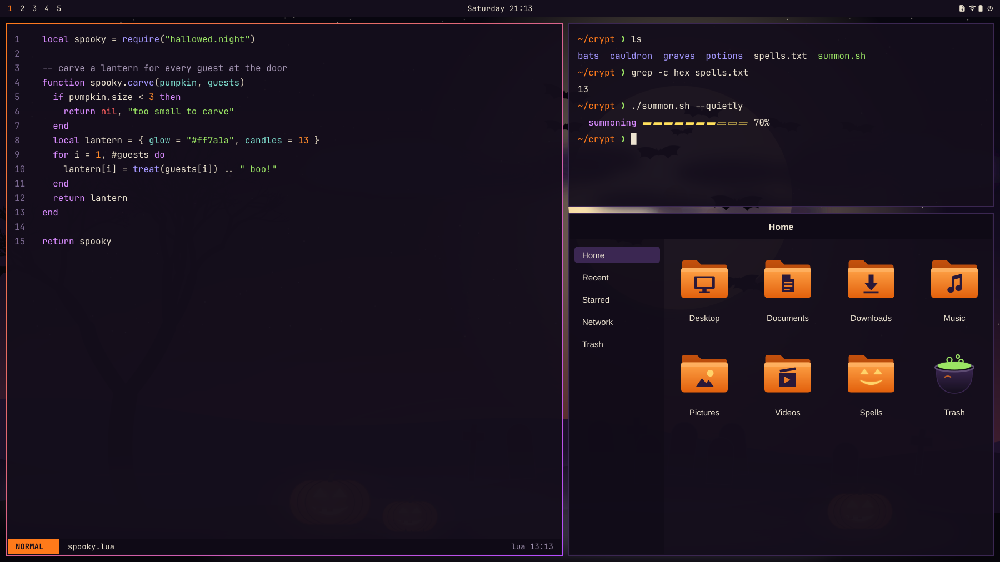

<div align="center">



# Hallowed Night

#### Night-violet sky, bone-white text, jack-o'-lantern orange, toxic green.

</div>

A theme for [Omarchy](https://omarchy.org) 4.

## Install

Run this in a terminal:

```bash
omarchy theme install https://github.com/sudharamachandranrajeev/omarchy-hallowed-night-theme
```

That sets the colours for every app, plus the wallpapers, lock screen and boot unlock logo.

## Get the full set

The matching icons, the screensaver art and the ultrawide wallpapers come from the
[omarchy-themes collection](https://github.com/sudharamachandranrajeev/omarchy-themes). Its installer adds them:

```bash
git clone https://github.com/sudharamachandranrajeev/omarchy-themes
cd omarchy-themes
./install.sh hallowed-night
```

## Licence

Code: MIT. Artwork: CC BY 4.0. See `LICENSE-ART.md`.

This repository is generated from [omarchy-themes](https://github.com/sudharamachandranrajeev/omarchy-themes). Please send changes there.
